<p align="center">
  
</p>

<h1 align="center">NATSLens</h1>

<p align="center">
  <strong>High-Performance NATS & JetStream Observability Studio, Consumer Lag Visualizer & KV Workbench</strong>
</p>

<p align="center">
  <a href="https://github.com/alexandrmotologa/natslens/releases"></a>
  <a href="https://golang.org"></a>
  <a href="https://react.dev"></a>
  <a href="https://nats.io"></a>
  <a href="LICENSE"></a>
</p>

<p align="center">
  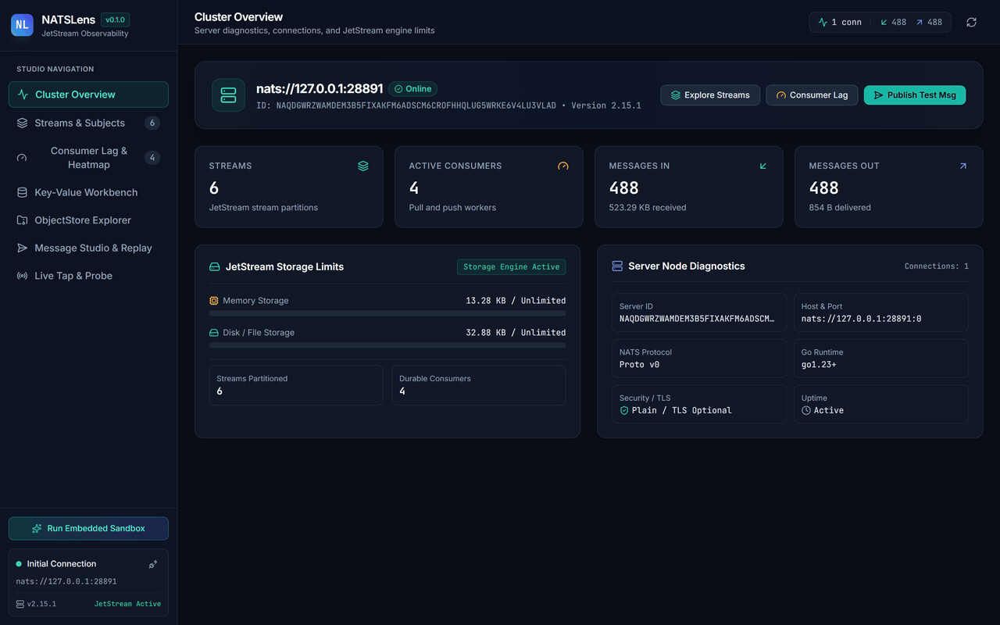
</p>

---

## Overview

NATS.io and JetStream have become foundational messaging backbones for distributed systems, microservices in Go and Rust, Kubernetes control planes, and edge compute topologies. While protocol-level tooling exists in terminal CLIs, engineering teams frequently lack an integrated graphical studio to inspect multi-tenant stream topologies, isolate consumer lag, debug Key-Value buckets, and execute controlled stream replays.

NATSLens delivers a self-contained, high-performance web studio compiled into a single static Go binary. It connects to any standard NATS 2.10+ deployment or runs an isolated, in-memory embedded JetStream cluster with simulated traffic for development and testing.

## Key Capabilities

### 1. Stream & Subject Hierarchy Visualizer
- Visualizes tree hierarchies for tokenized wildcard subjects (`orders.created`, `orders.fulfilled`, `telemetry.us-east.>`).
- Displays stream storage allocations, retention configurations (Limits, Interest, WorkQueue), deduplication windows, and discarded policy mechanics.
- Inspects real message payloads, structured JSON trees, timestamps, and sequence numbers.
- Deletes individual sequence records or purges entire streams.
- Exports stream message slices to portable JSON snapshots.

### 2. Real-Time Consumer Lag & Redelivery Heatmap
- Computes pending message counts across all durable and ephemeral consumers.
- Surfaces unacknowledged in-flight messages (`AckPending`) and highlights consumer timeouts exceeding configured `AckWait` limits.
- Tracks redelivery ratios to detect poison pills, unhandled panics, and stalled worker goroutines before queue buildup cascades into outages.
- Supports consumer lifecycle operations: create push/pull consumers, pause message delivery, resume consumption, or delete consumers.

### 3. Visual Topology & Dataflow Graph
- Automatically constructs an interactive SVG dataflow graph of your NATS cluster.
- Maps the path from External Ingress through Wildcard Subjects, JetStream Streams, Durable Consumers, and Active Worker Groups.
- Visualizes message throughput counters and flags degraded consumer nodes directly in the graph layout.

### 4. Poison Pill Quarantine & Dead Letter Queue (DLQ)
- Scans streams for messages that have breached delivery thresholds or caused repeated worker failures.
- Quarantines poison pills in an isolated inspection workbench.
- Provides an in-place JSON payload repair editor to fix invalid schemas or corrupt payloads.
- Re-publishes repaired messages back to original or alternative subjects with automated original acking.

### 5. Schema Registry & Live Payload Validator
- Centralized repository of JSON Schema contracts bound to NATS subject patterns (`orders.*`, `telemetry.>`).
- Pattern-matching engine that resolves concrete message subjects against schema bindings.
- Interactive validator playground to test JSON payloads against schemas with pinpoint error reporting.

### 6. Traffic Generator & Chaos Studio
- Configurable synthetic load generator for continuous stress testing of streams and consumers.
- Dynamic template variables (`{{uuid}}`, `{{now}}`, `{{random_int}}`, `{{subject}}`) for realistic message generation.
- Built-in chaos engineering knobs: inject configurable latency jitter, payload corruption ratios, and error header flags.

### 7. Alerts Engine & Prometheus Exporter
- Native `/metrics` endpoint exporting Prometheus text-format metrics for streams, consumers, lag, and redeliveries.
- Configurable threshold alert rules evaluating consumer lag, AckWait timeouts, and unacknowledged messages.
- Webhook notification engine supporting Slack, Discord, and generic JSON webhook destinations with incident logs.

### 8. JetStream Key-Value & ObjectStore Workbench
- Explores keys, revisions, and raw values across native NATS Key-Value buckets.
- Tracks revision history per key with byte-level delta inspection.
- Provides real-time Server-Sent Events (SSE) updates as keys are mutated or marked deleted.
- Supports one-click JSON snapshot export and full bucket import.
- Manages NATS ObjectStore buckets with direct file upload, metadata tracking, download, and deletion.

### 9. Message Studio, Deduplication & Stream Replay Engine
- Publishes test messages to any subject with custom header injectors, including `Nats-Msg-Id` for JetStream deduplication testing.
- Sets expected stream headers (`Nats-Expected-Stream`, `Nats-Expected-Last-Seq`, `Nats-Expected-Last-Msg-Id`) for deterministic testing.
- Replays historic streams starting from sequence IDs, absolute timestamps, or specific delta windows.
- Paces replay delivery with selectable playback speeds (1x, 2x, 5x, 10x, or unthrottled maximum throughput).

### 10. Core NATS Live Tap, Probe & Command Palette
- Sniffs raw subject traffic across Core NATS with live pattern filtering and wildcard subscription support.
- Runs synchronous request-reply probes with nanosecond latency round-trip measurements.
- Universal Command Palette (`Ctrl+K` / `Cmd+K`) for rapid navigation across streams, consumers, KV buckets, and studio actions.

### 11. Zero-Dependency In-Process Demo Cluster
- Bundles a full in-memory NATS JetStream server (`natslens demo`).
- Pre-seeds active streams (`ORDERS`, `PAYMENTS`, `TELEMETRY`), durable consumers, KV buckets (`app-config`, `rate-limits`), and ObjectStore buckets (`documents`).
- Continuously generates live synthetic event traffic for instant evaluation without external infrastructure.

---

## Screenshots

<p align="center">
  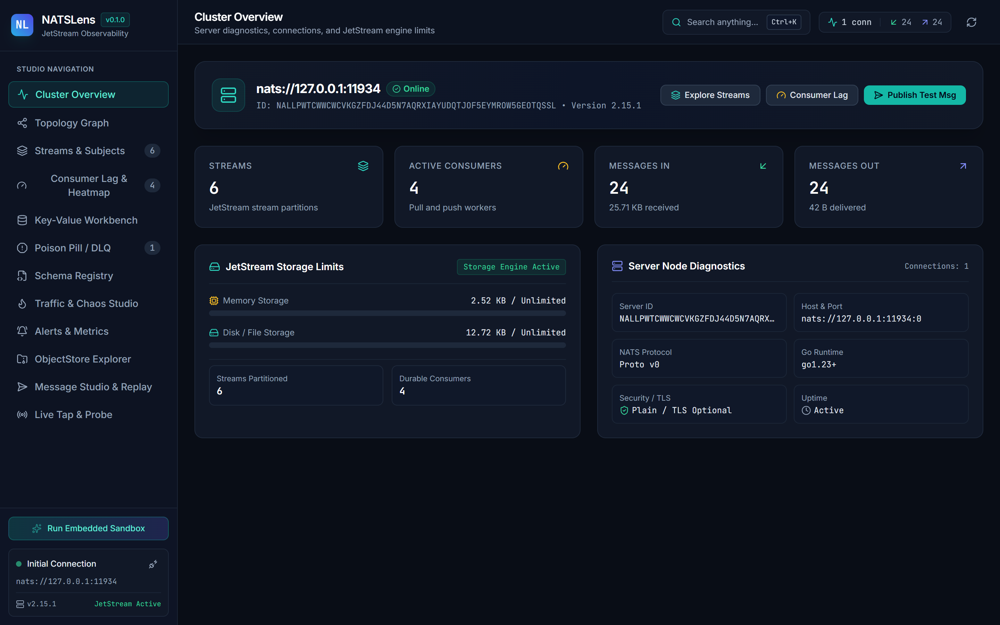
</p>
<p align="center"><em>Cluster Overview: Cluster metrics, connections, and JetStream storage allocation limits.</em></p>

<br />

<p align="center">
  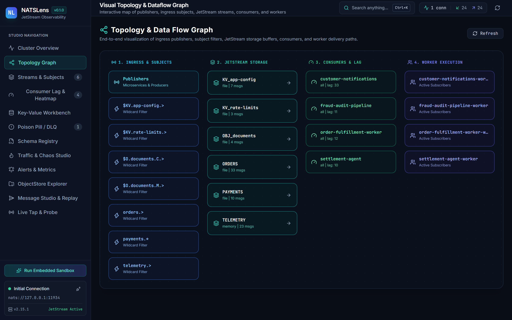
</p>
<p align="center"><em>Topology Graph: Interactive SVG map of ingress, subjects, streams, consumers, and workers.</em></p>

<br />

<p align="center">
  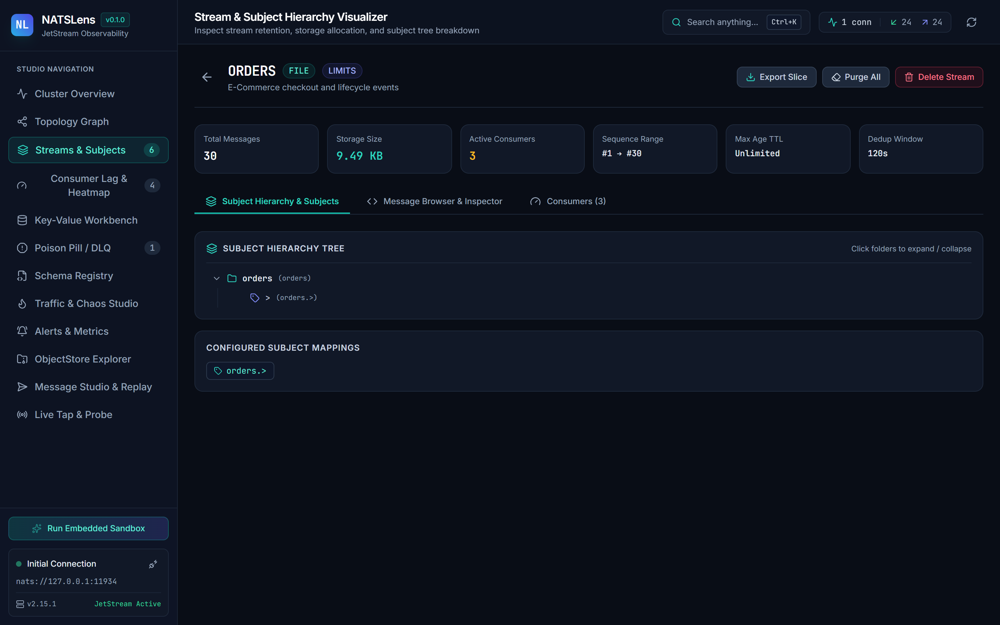
</p>
<p align="center"><em>Stream & Subject Hierarchy: Deep message browsing, header inspection, and payload decoding.</em></p>

<br />

<p align="center">
  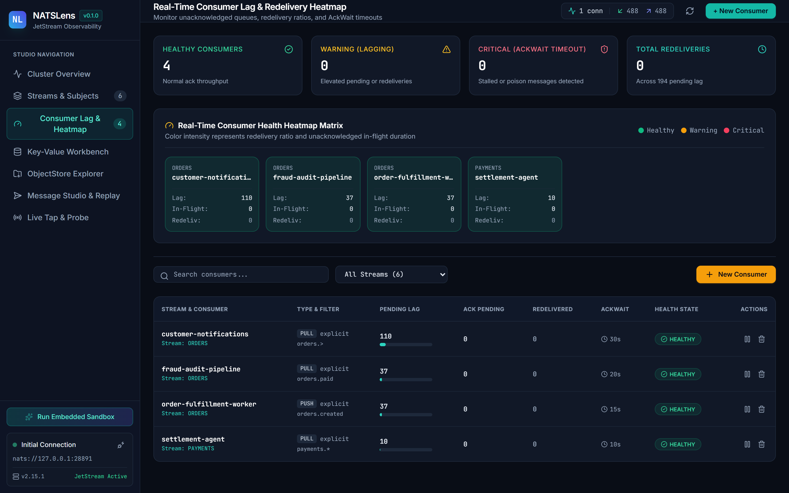
</p>
<p align="center"><em>Consumer Lag & Redelivery Heatmap: Real-time tracking of pending messages, redeliveries, and AckWait badges.</em></p>

<br />

<p align="center">
  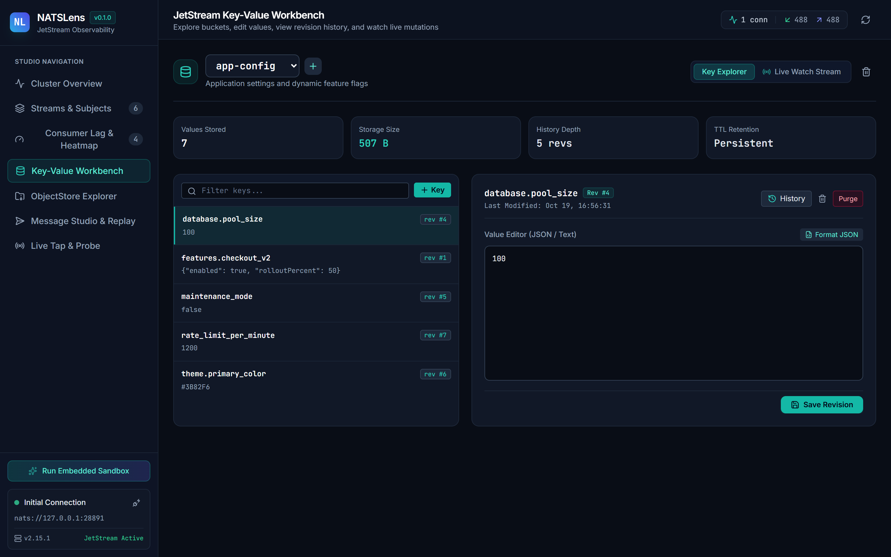
</p>
<p align="center"><em>Key-Value Workbench: Key inspection, mutation tracking, historical revisions, and JSON import/export.</em></p>

<br />

<p align="center">
  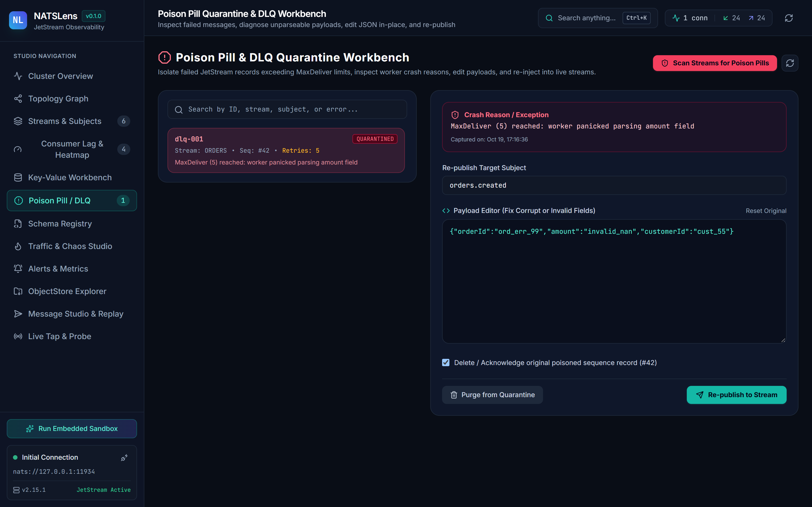
</p>
<p align="center"><em>Poison Pill DLQ: Quarantined failed messages, in-place JSON repair editor, and re-publishing.</em></p>

<br />

<p align="center">
  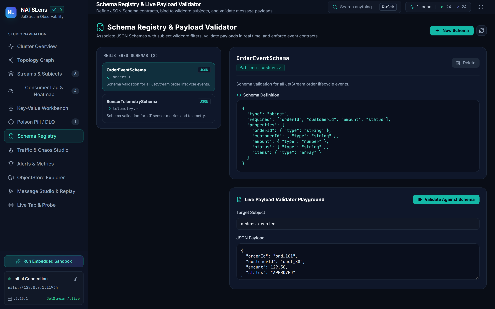
</p>
<p align="center"><em>Schema Registry: JSON Schema contracts, wildcard subject bindings, and live validator playground.</em></p>

<br />

<p align="center">
  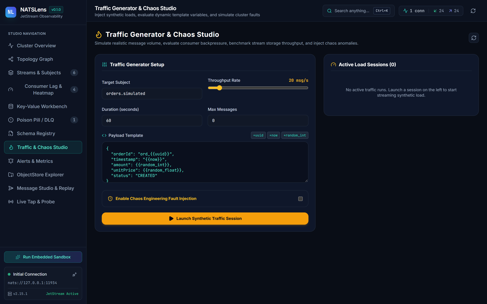
</p>
<p align="center"><em>Traffic Studio: Synthetic load generation with template variables and chaos fault injection knobs.</em></p>

<br />

<p align="center">
  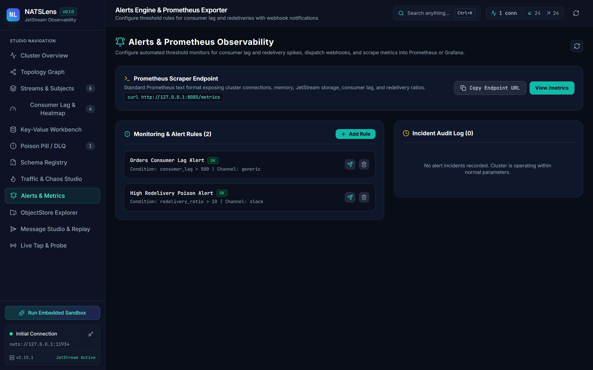
</p>
<p align="center"><em>Alerts Engine: Threshold rules, incident event log, and raw /metrics Prometheus scraper endpoint.</em></p>

<br />

<p align="center">
  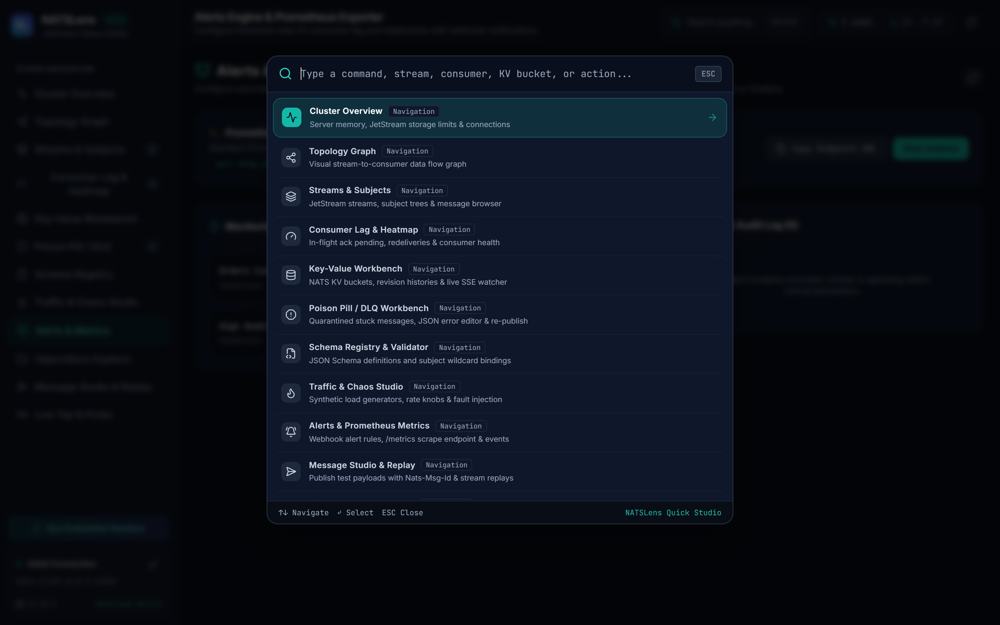
</p>
<p align="center"><em>Command Palette: Universal quick-switcher (Ctrl+K) across streams, consumers, buckets, and actions.</em></p>

---

## Architecture

NATSLens is engineered as a single Go binary that bundles both the backend server and compiled React 19 frontend assets via Go's native `embed.FS`.

```
                    ┌────────────────────────────────────────────────────────┐
                    │                      NATSLens Studio                   │
                    │               (React 19 + Tailwind CSS)                │
                    └───────────┬────────────────────────────────┬───────────┘
                                │ REST API                       │ SSE Streams
                                ▼                                ▼
┌────────────────────────────────────────────────────────────────────────────┐
│                             Go 1.23 HTTP Server                            │
│                  - Static Asset Server (go:embed all:ui/dist)              │
│                  - REST Endpoints (/api/cluster, /api/streams, /api/kv)    │
│                  - Real-Time SSE Handlers (/api/events, /api/tap)          │
│                  - Replay Speed Controller & Background Workers            │
└─────────────────────────────────────┬──────────────────────────────────────┘
                                      │
                     ┌────────────────┴────────────────┐
                     ▼                                 ▼
      ┌──────────────────────────────┐  ┌──────────────────────────────┐
      │   External NATS Deployment   │  │ Embedded In-Memory Server    │
      │   - Anonymous, Token, User   │  │ - nats-server/v2 In-Process  │
      │   - NKeys / Credentials      │  │ - Pre-seeded Mock JetStream  │
      │   - TLS / Custom Certs       │  │ - Synthetic Event Generator  │
      └──────────────────────────────┘  └──────────────────────────────┘
```

---

## Quick Start

### Option 1: Run the Embedded Demo (Zero Config)

No NATS cluster is needed. This launches an in-process JetStream cluster with active streams, consumers, KV stores, and live traffic:

```bash
# Using go run directly
go run main.go demo --port 8085

# Or using precompiled binary
natslens demo --port 8085
```

Open `http://localhost:8085` in your browser.

### Option 2: Connect to an Existing NATS Cluster

```bash
# Connect to local or remote NATS cluster
natslens server --nats-url nats://localhost:4222 --port 8085

# Connect with authentication credentials file
natslens server --nats-url tls://connect.ngs.global:4222 --creds /path/to/user.creds

# Connect with auth token
natslens server --nats-url nats://localhost:4222 --token s3cr3t_t0k3n
```

### Option 3: Install via Go

```bash
go install github.com/alexandrmotologa/natslens@latest
natslens demo
```

---

## CLI Reference

### `natslens demo`

Launches the web UI backed by an internal, zero-dependency JetStream server with live traffic simulation.

```bash
Flags:
  -p, --port int         HTTP server port (default 8085)
      --host string      HTTP server bind interface (default "127.0.0.1")
```

### `natslens server`

Starts NATSLens connected to a live Core NATS or JetStream server.

```bash
Flags:
  -p, --port int         HTTP server port (default 8085)
      --host string      HTTP server bind interface (default "127.0.0.1")
  -s, --nats-url string  NATS connection URL (default "nats://localhost:4222")
  -u, --user string      Username for authentication
      --password string  Password for authentication
  -t, --token string     Authentication token
  -c, --creds string     Path to NATS .creds file
  -k, --nkey string      NKey seed string
      --insecure         Skip TLS certificate verification
```

### `natslens version`

Prints the current version, Git commit SHA, and Go runtime build information.

---

## REST & SSE API Reference

NATSLens exposes a structured JSON API consumed by the frontend and available for automation scripts:

| Endpoint | Method | Description |
|:---|:---|:---|
| `/api/health` | `GET` | Health status and uptime |
| `/api/connection` | `GET`, `POST`, `DELETE` | Current connection status, connect, or disconnect |
| `/api/cluster` | `GET` | Cluster metadata, JetStream limits, and memory usage |
| `/api/streams` | `GET`, `POST` | List all streams or create a new JetStream stream |
| `/api/streams/{name}` | `GET`, `DELETE` | Stream configuration, state, or stream deletion |
| `/api/streams/{name}/purge` | `POST` | Purge messages from a stream |
| `/api/streams/{name}/messages` | `GET` | Browse messages by sequence offset and subject filter |
| `/api/streams/{name}/messages/{seq}` | `DELETE` | Delete an individual message by sequence number |
| `/api/streams/{name}/hierarchy` | `GET` | Subject tree hierarchy for stream |
| `/api/consumers` | `GET`, `POST` | List consumers with lag metrics or create consumer |
| `/api/consumers/{stream}/{name}` | `GET`, `DELETE` | Consumer details or consumer deletion |
| `/api/consumers/{stream}/{name}/pause` | `POST` | Pause or resume message delivery for a consumer |
| `/api/kv` | `GET`, `POST` | List KV buckets or create a new bucket |
| `/api/kv/{bucket}` | `GET`, `DELETE` | List keys in a bucket or delete bucket |
| `/api/kv/{bucket}/{key}` | `GET`, `PUT`, `DELETE` | Read value, put key value, or delete key |
| `/api/kv/{bucket}/{key}/history` | `GET` | Revision history log for key |
| `/api/kv/{bucket}/watch` | `GET` | SSE stream of live mutations in KV bucket |
| `/api/objectstore` | `GET`, `POST` | List ObjectStore buckets or create bucket |
| `/api/objectstore/{bucket}` | `GET`, `DELETE` | List objects in bucket or delete bucket |
| `/api/objectstore/{bucket}/upload` | `POST` | Upload binary object with custom metadata |
| `/api/objectstore/{bucket}/{name}` | `GET`, `DELETE` | Download object or delete object |
| `/api/publish` | `POST` | Publish message with deduplication & trace headers |
| `/api/replays` | `GET`, `POST` | List active replay sessions or start stream replay |
| `/api/replays/{id}` | `DELETE` | Stop an active replay session |
| `/api/tap` | `GET` | SSE stream for live Core NATS packet capture |
| `/api/probe` | `POST` | Run synchronous request-reply probe with latency timer |
| `/api/events` | `GET` | SSE stream of cluster-wide events and statistics |
| `/metrics` | `GET` | Prometheus text-format metric scrape endpoint |
| `/api/topology` | `GET` | Live dataflow graph (Ingress, Subjects, Streams, Consumers, Workers) |
| `/api/schemas` | `GET`, `POST` | List or register JSON Schema contracts |
| `/api/schemas/{id}` | `GET`, `DELETE` | Read or delete schema contract definition |
| `/api/schemas/validate` | `POST` | Validate JSON payload against matched subject schema |
| `/api/dlq` | `GET` | List quarantined poison pills and failed delivery messages |
| `/api/dlq/scan` | `POST` | Trigger stream scan for stuck messages |
| `/api/dlq/republish` | `POST` | In-place payload repair and automated re-publish |
| `/api/dlq/{id}` | `DELETE` | Purge quarantined poison pill from dead letter list |
| `/api/traffic/start` | `POST` | Launch synthetic traffic generator with chaos injection |
| `/api/traffic/stop` | `POST` | Stop active synthetic load test session |
| `/api/traffic/sessions` | `GET` | List running traffic generator sessions |
| `/api/alerts/rules` | `GET`, `POST` | List or register threshold alert rules |
| `/api/alerts/rules/{id}` | `DELETE` | Delete threshold alert rule |
| `/api/alerts/events` | `GET` | Incident log of triggered threshold alert events |
| `/api/alerts/test` | `POST` | Test webhook notification (Slack, Discord, generic JSON) |
| `/api/streams/{name}/export` | `GET` | Export stream message slice to portable JSON snapshot |
| `/api/kv/{bucket}/export` | `GET` | Export full Key-Value bucket snapshot to JSON |
| `/api/kv/{bucket}/import` | `POST` | Import Key-Value bucket snapshot from JSON |

---

## Building from Source

### Prerequisites
- Go 1.23 or newer
- Node.js 20 or newer
- npm 10 or newer

```bash
# Clone the repository
git clone https://github.com/alexandrmotologa/natslens.git
cd natslens

# Build the frontend assets
cd ui
npm install
npm run build
cd ..

# Run tests
go test -v ./...

# Build the single standalone executable
go build -o natslens.exe main.go

# Start the demo mode
./natslens.exe demo --port 8085
```

---

## License

This project is licensed under the MIT License. See [LICENSE](LICENSE) for details.
